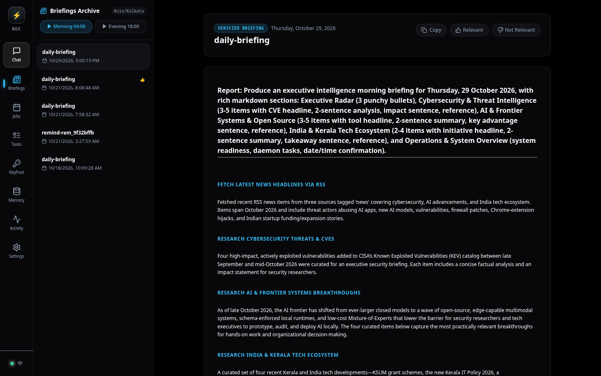
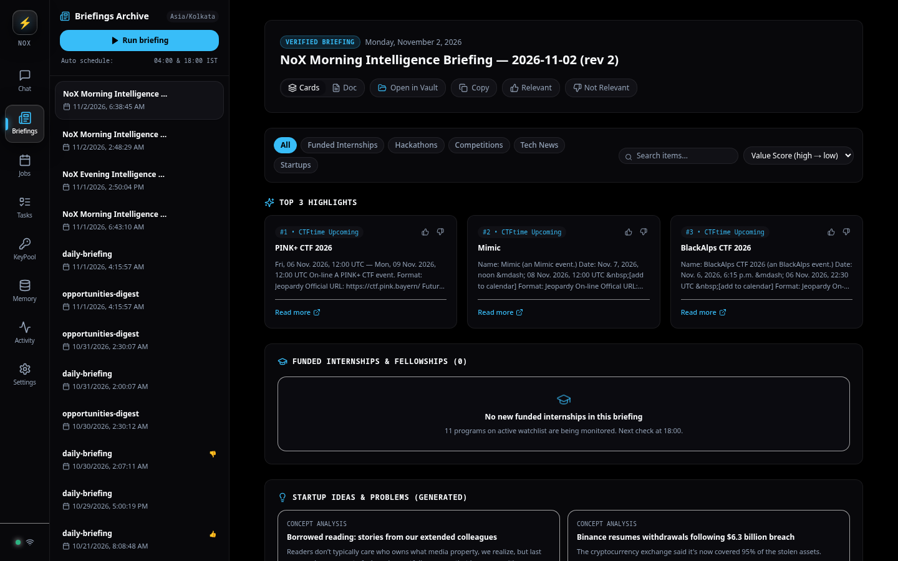
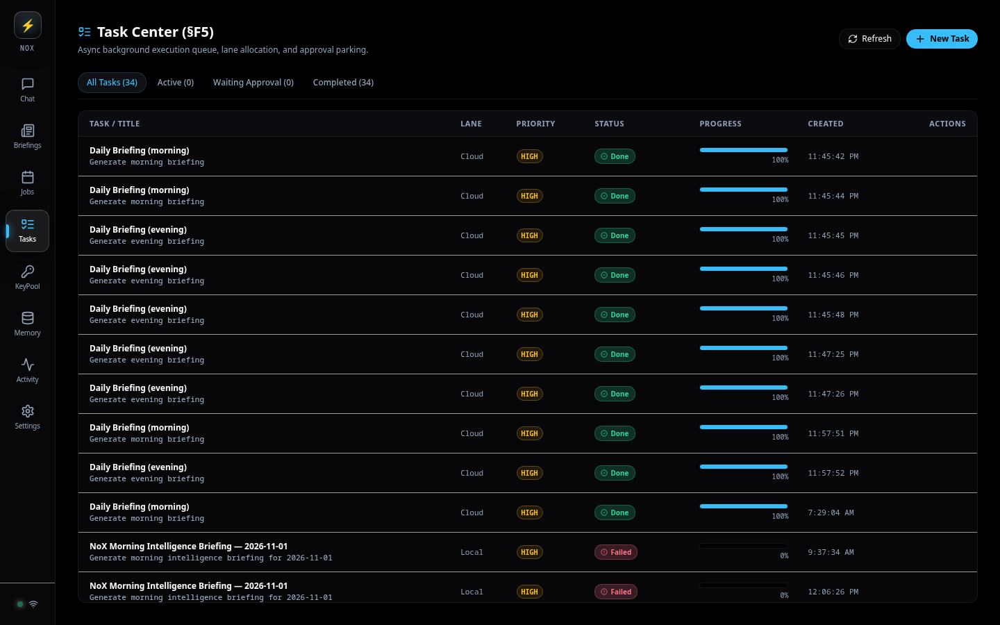
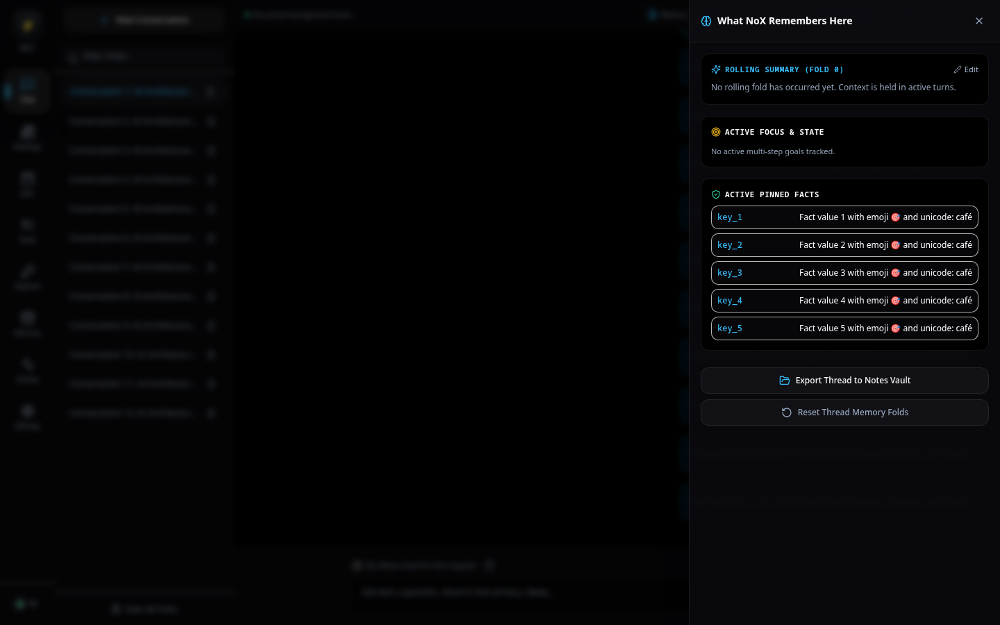
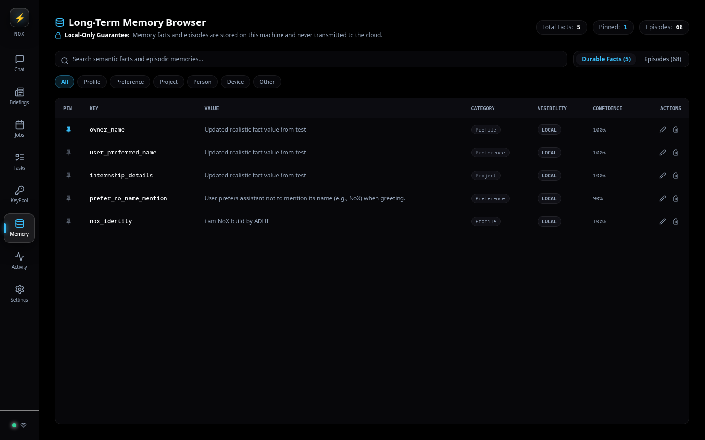
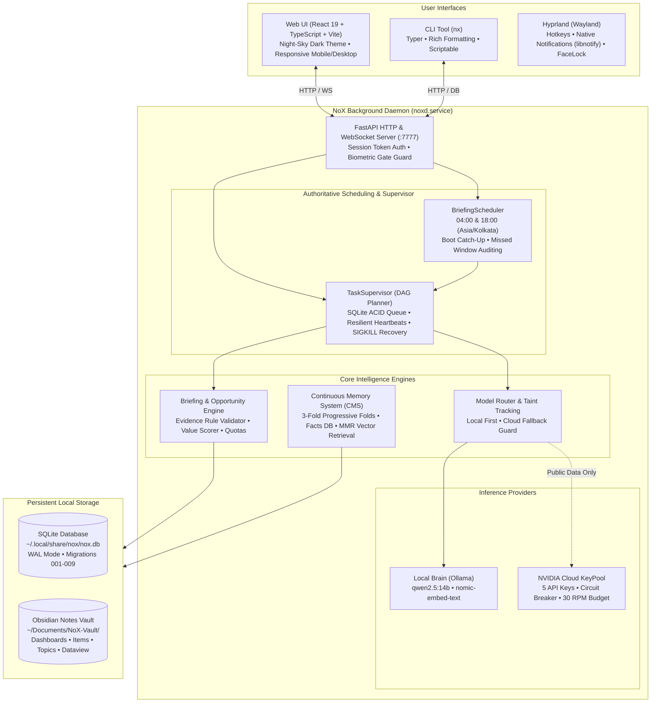

# 🌌 NoX — Autonomous Personal AI Agent

<p align="center">
  
</p>

<p align="center">
  <strong>A 24/7 autonomous, local-first intelligence agent and personal executive running on Arch Linux & Hyprland.</strong><br>
  Built with dual-lane local/cloud inference, continuous memory distillation, authoritative intelligence briefings, and bidirectional Obsidian vault synchronization.
</p>

<p align="center">
  
  
  
  
  
  
  
  
</p>

---

## ⚡ The Vision: Why NoX?

Most modern AI assistants are **ephemeral, cloud-dependent, and passive**:
* They forget everything the moment you close the tab.
* They leak your personal code, notes, and profile to third-party cloud servers.
* They require you to prompt them manually instead of working continuously on your behalf.
* They produce isolated answers instead of organizing knowledge into your personal second brain.

**NoX** (pronounced *"knocks"*, short for **Nocturnal Operating eXecutive**) was engineered from the ground up to invert this paradigm:

1. **🔒 Absolute Privacy & Local-First Sovereign Brain**:
   Your personal conversations, memories, facts, and local files are computed locally by default via Ollama (`qwen2.5:14b`). Sensitive data **never** touches external servers. An automated **Taint Protection Engine** cryptographically blocks private data from ever egressing to cloud endpoints.
2. **⚡ Dual-Lane Hybrid Intelligence**:
   When deep public web research or high-token summarization is needed, NoX seamlessly bursts workloads to **NVIDIA NIM** cloud models (`nvidia/nemotron-3.5-lightning-30b-a3b`, `meta/llama-3.3-70b-instruct`) using a resilient 5-key pooling allocator with automatic failover, circuit breakers, and rate-budget reservation.
3. **📰 Authoritative Daily Intelligence Briefings**:
   An authoritative background scheduler wakes at **04:00 (Morning Slot)** and **18:00 (Evening Slot)** in your local timezone (`Asia/Kolkata`). It crawls verified tech news, research papers, releases, and cybersecurity feeds, compiling structured markdown briefings and updating your Obsidian vault while you sleep.
4. **🎓 Opportunity Intelligence (Internships, Hackathons & CTFs)**:
   Scouts global **Funded Internships** (with verified accommodation and stipend), **Hackathons**, and **CTFs**. Enforces a strict **Evidence Rule** (requiring verbatim official quotes for benefits), calculates a 0–100 value score, and provides a full interactive board with one-click status transitions (`applied`, `interview`, `offer`).
5. **📓 Bidirectional Obsidian Vault Synchronization**:
   NoX writes directly to your local **Obsidian Notes Vault** (`~/Documents/NoX-Vault/`). Briefings, opportunities, and chat threads are rendered as clean Markdown notes with YAML frontmatter, atomic boundaries (`%% nox:begin %%` / `%% nox:end %%`), and live Dataview queries. Your own personal notes outside the markers are preserved indefinitely across syncs.
6. **🛡️ Biometric Wayland Gate & Approval Guardrails**:
   Tight OS integration with Hyprland on Arch Linux. Protects UI and CLI access through biometric camera authentication (`facelock`) and enforces explicit approval modals with countdown timers before executing any destructive or system-altering actions.

---

## 📸 Interface Showcase

<p align="center">
  
  
</p>
<p align="center">
  
  
</p>

---

## 🏛️ System Architecture



---

## 🌟 Key Capabilities

### 1. Dual-Lane Hybrid Intelligence
NoX employs a smart router that categorizes every workload into one of two lanes:
* **Local Lane (Sovereign)**: Uses local Ollama models (`qwen2.5:14b` for reasoning, `nomic-embed-text` for embeddings, and `gemma4:e4b` for vision). All chats containing personal facts, sensitive topics, local files, or code are processed exclusively on your GPU/CPU.
* **Cloud Lane (Burst Research)**: For public tasks (scraping release notes, summarizing technical whitepapers, compiling news digests), NoX can burst to NVIDIA NIM cloud models.
* **Taint Engine**: Before any prompt is routed to the cloud, NoX inspects the request context against memory, local paths, and private entities. If tainted, the cloud request is rejected and forced back to the local model.
* **CLI Cloud Toggle**: Toggle cloud capabilities instantly with `nx cloud on`, `nx cloud off`, or inspect health with `nx cloud status`.

### 2. Autonomous Daily Briefings & Missed-Window Honesty
* **Authoritative Clock**: Operates in your explicit timezone (`Asia/Kolkata`) with slots at `04:00` (Morning) and `18:00` (Evening).
* **Sleep Drift Detection**: Monotonically tracks hardware sleep cycles. If your laptop was closed during an active window, NoX detects the wake event and runs an immediate non-duplicate boot catch-up.
* **Honest Audit History**: If a scheduled slot elapsed completely while the machine was powered off, NoX records an unvarnished audit entry (`state='missed'`) into SQLite rather than hallucinating or backdating stale data.
* **Live Progress Streaming**: Watch topics assemble in real time with WebSocket progress bars and per-topic status tags (`collecting`, `done`).

### 3. Opportunity Intelligence: Funded Internships & Hackathons
NoX continuously monitors premier global opportunities and applies strict verification:
* **The Evidence Rule**: No opportunity is labeled "Funded" without an exact verbatim quote from official documentation confirming accommodation, stipend, or travel coverage.
* **Multi-Factor Value Scoring (0–100)**:
  $$\text{Score} = \text{Housing} (+30) + \text{Stipend} (+25) + \text{Travel} (+15) + \text{Prestige} (+15) + \text{Eligibility} (+15)$$
* **Watchlist Seeds**: Monitors top programs including **CERN Summer Student Programme**, **IST Austria ISTernship**, **Mitacs Globalink**, **ETH Zurich SSRF**, **MLH Fellowship**, **Outreachy**, **Google Summer of Code (GSoC)**, **Devpost Global**, and **Major League Hacking**.
* **Strict CTF Cap**: Caps CTF challenges at `<= 3` per digest to keep briefings balanced and actionable.
* **Opportunity Registry & Status Synchronization**: Track applications directly in the UI or CLI across states: `new` → `interested` → `applied` → `interview` → `offer` → `rejected` / `dismissed`.

### 4. Plain Markdown Obsidian Vault Integration
* **Native Obsidian Vault**: Synchronizes directly with `~/Documents/NoX-Vault/`.
* **Automated Dashboards**:
  * `Dashboards/Internships Tracker.md`: Sorts active funded programs by value score with Dataview tables and static fallback grids.
  * `Dashboards/Hackathons.md`: Live tracking of upcoming hackathons, modes (remote/onsite), and prize pools.
  * `Dashboards/Deadlines.md`: Automatic urgent highlighting for opportunities closing within 7 days.
  * `Dashboards/Opportunities Board.md`: Global competitions and CTF rankings.
  * `Dashboards/Reading Queue.md`: Triaged technical articles and papers with source attribution.
* **Atomic Boundary Guarantee**: Content between `%% nox:begin %%` and `%% nox:end %%` is maintained by NoX; your own personal notes and annotations outside the markers are preserved indefinitely across regenerations.

### 5. Resilient Task Supervisor (DAG Engine)
* **ACID SQLite Queues**: Tasks persist in SQLite (`tasks` table) under WAL mode.
* **Crash & SIGKILL Recovery**: If the daemon is forcibly killed or the host reboots mid-task, stale heartbeats are detected upon restart and cleanly resumed or transitioned to `interrupted`.
* **Dynamic Tree Plans**: Visualizes complex, multi-step subtasks with interactive node graphs in the web dashboard.

---

## 💻 CLI Commands (`nx`)

NoX includes a command-line interface with shell completions, rich tables, and scriptable JSON output:

| Command | Description | Example |
|---|---|---|
| `nx run` | Start the daemon in foreground | `nx run` |
| `nx status` | Display daemon status and health diagnostics | `nx status` |
| `nx doctor` | Comprehensive environment audit (26+ checks) | `nx doctor` |
| `nx chat <msg>` | Fast terminal chat session with local/cloud lane | `nx chat "Explain quantum decoherence"` |
| `nx briefing status` | Show scheduler clock, next slot, and run history | `nx briefing status` |
| `nx briefing run` | Trigger on-demand briefing pipeline run | `nx briefing run --wait --force` |
| `nx briefing list` | List recent briefing runs and generation times | `nx briefing list -n 5` |
| `nx cloud status` | Show cloud health, circuit breaker & RPM budget | `nx cloud status` |
| `nx cloud on\|off` | Enable or disable NVIDIA Cloud burst lane | `nx cloud on` |
| `nx notes open` | Open the Notes Vault in Obsidian or default editor | `nx notes open` |
| `nx keys status` | Inspect live 5-key NVIDIA KeyPool allocator | `nx keys status` |
| `nx memory search` | Query memory facts and semantic vector episodes | `nx memory search "internship"` |

---

## 🚀 Quickstart

### Prerequisites
* **Operating System**: Linux (developed and optimized for Arch Linux with Hyprland).
* **Python**: 3.11+ (Python 3.14 verified).
* **Ollama**: Installed and running (`ollama serve`).
* **Node.js**: v18+ & npm (for Web UI build).
* **System Tools**: `libnotify` (`notify-send`), `sqlite3`.

### 1. Automated Installation
Clone the repository and run the automated installer:

```bash
git clone https://github.com/callme-ADHI/NoX---AI.git ~/nox
cd ~/nox
bash scripts/install.sh
```

### 2. Configure Local Models
Pull the recommended Ollama models:

```bash
ollama pull nomic-embed-text
ollama pull qwen2.5:14b
ollama pull gemma4:e4b
```

### 3. Optional: Add NVIDIA Cloud Keys (Free Tier)
To enable cloud burst research for public web scraping and heavy synthesis:
1. Obtain free API keys from [build.nvidia.com](https://build.nvidia.com/).
2. Add them to your local secrets file:
   ```bash
   mkdir -p ~/.config/nox
   echo 'NVIDIA_API_KEY=nvapi-YOUR_KEY_HERE' > ~/.config/nox/secrets.env
   chmod 600 ~/.config/nox/secrets.env
   ```
*(You can also configure up to 5 keys as a comma-separated list or in `config.toml` for multi-key pool load balancing).*

### 4. Verify System Readiness
Run the built-in diagnostic doctor:

```bash
nx doctor
```

### 5. Launch Daemon & Web UI
Start the background daemon service:

```bash
# Via systemd (recommended)
systemctl --user enable --now noxd.service

# Or directly in terminal
nx run
```

Access the Web UI at **`http://127.0.0.1:7777`** or run:

```bash
nx open
```

---

## 📁 Repository Structure

```text
NoX/
├── src/noxai/                     # Core Python Backend
│   ├── api/                       # FastAPI REST routes & WebSocket handlers
│   ├── briefing/                  # Briefing engine, scheduler, and opportunity scorer
│   │   ├── engine.py              # Evidence Rule validator & opportunity collector
│   │   └── scheduler.py           # Authoritative clock, boot catch-up & missed window recorder
│   ├── commands/                  # Typer CLI subcommands (briefing, cloud, doctor, notes, etc.)
│   ├── models/                    # Model router, Ollama client, NVIDIA NIM & KeyPool
│   ├── notes/                     # Obsidian Vault sync & atomic markdown boundary manager
│   ├── research/                  # SSRF-safe web crawler, RSS parsers & source engines
│   ├── tasks/                     # TaskSupervisor DAG engine & ACID SQLite queues
│   ├── config.py                  # Strict Pydantic configuration schemas
│   ├── db.py                      # Database migrations (001-009) & SQLite connection pool
│   └── doctor.py                  # System diagnostic checks
├── ui/                            # React 19 Frontend
│   ├── src/                       # TypeScript components, pages & state
│   │   ├── pages/                 # BriefingsPage, ChatPage, TasksPage, MemoryPage, JobsPage
│   │   ├── components/            # NavRail, Starfield, OpportunityCard, ApprovalCard
│   │   └── services/              # API and WebSocket client bindings
│   ├── e2e/                       # Playwright end-to-end browser test suite (11 tests)
│   └── package.json
├── programs.example.toml          # Verified watchlist seed for internships & hackathons
├── tests/                         # Pytest test suite (37+ unit & integration tests)
├── docs/
│   ├── audits/                    # Architecture audits (automation, session review, program probes)
│   └── screenshots/               # High-res desktop & mobile UI captures
└── README.md
```

---

## 🔒 Security & Privacy Architecture

* **Zero Cloud Taint**: User memory facts, conversation histories, and local files are marked tainted and never dispatched to external cloud APIs.
* **SSRF-Safe Web Crawler**: Built-in IP validation blocks loopback (`127.0.0.0/8`), private networks (`RFC 1918`), link-local, IPv6 NAT64 mappings, and cloud metadata endpoints (`169.254.169.254`).
* **Secrets Isolation**: API keys and tokens are stored in `~/.config/nox/secrets.env` with strict `0600` Linux permissions, separate from version-controlled configuration.
* **Write-Tier Approval Modals**: Destructive operations (modifying system files, editing systemd services, executing commands) require explicit interactive user approval in the UI or CLI with countdown auto-rejection.
* **Biometric Wayland Gate**: Integrates with Hyprland to lock access until facial verification succeeds.

---

## 🧪 Testing & Quality Assurance

NoX maintains comprehensive automated testing across all layers:

```bash
# 1. Run Python unit & integration tests
uv run pytest tests/ -v

# 2. Run static analysis & linting
uv run ruff check src/ tests/

# 3. Run UI unit tests (Vitest)
cd ui && npm test

# 4. Run full Playwright browser E2E test suite (11 tests)
cd ui && npx playwright test
```

---

## 📜 License

Licensed under the [MIT License](LICENSE). Built for sovereign, local-first intelligence.
