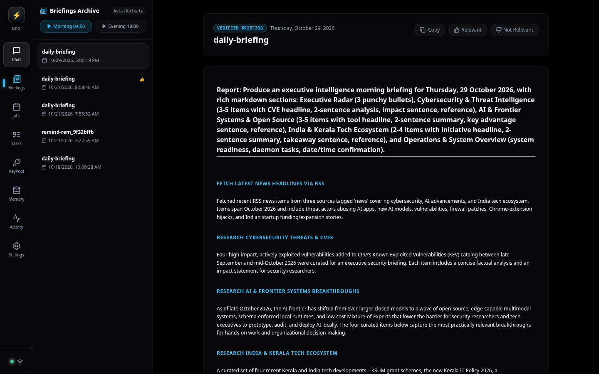
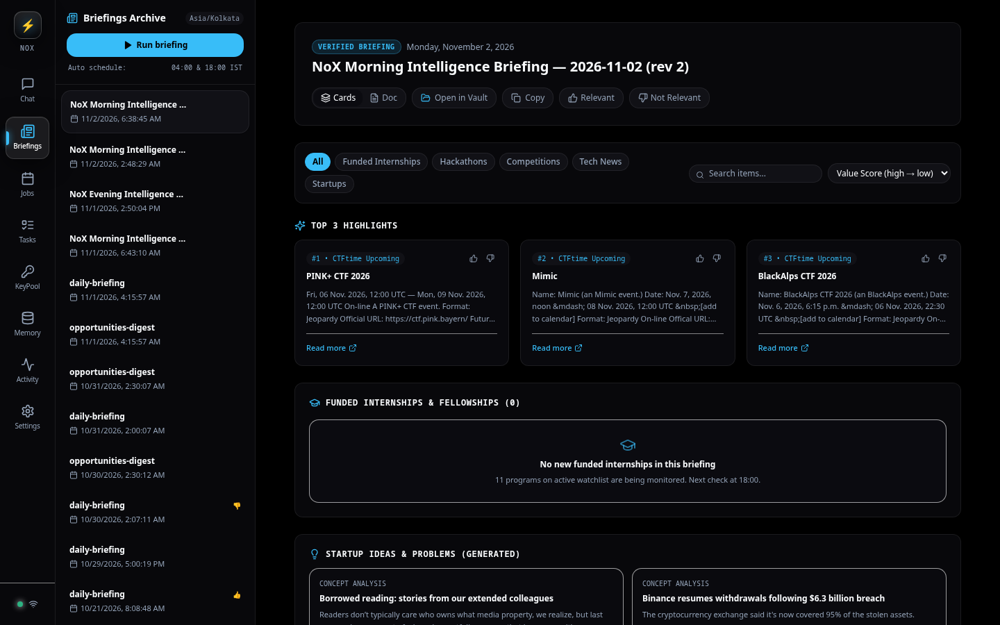
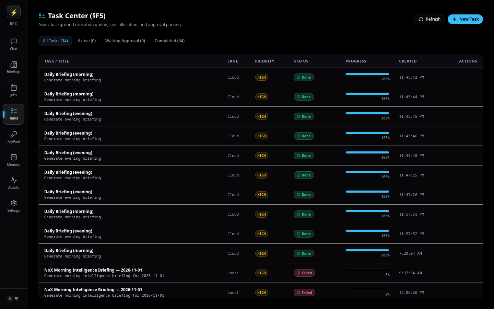
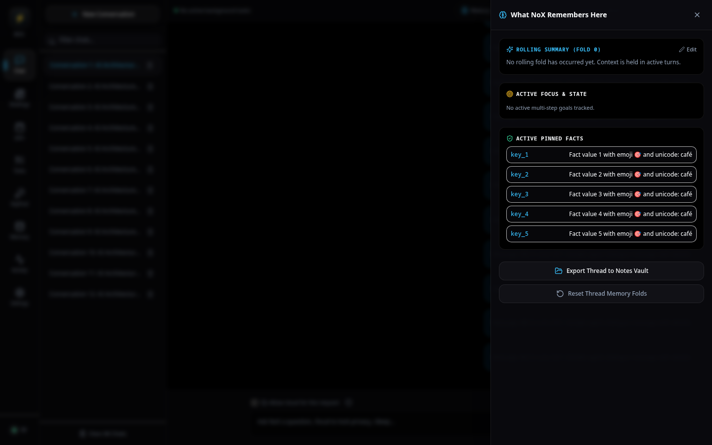
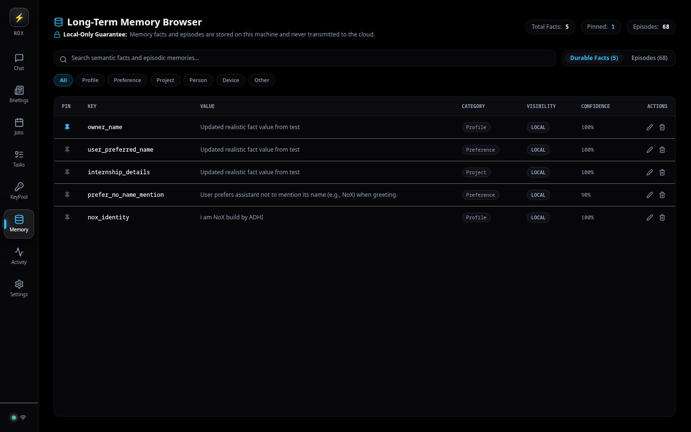
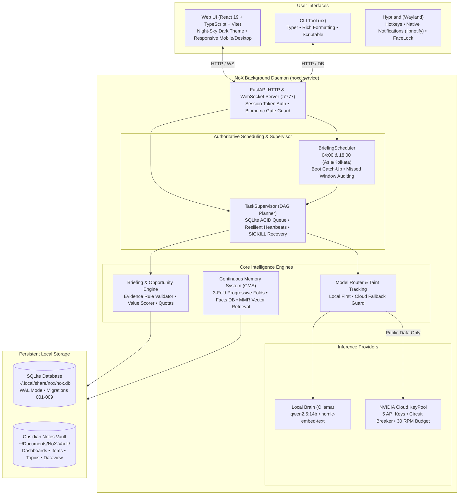

# 🌌 NoX — Autonomous Personal AI Agent

<p align="center">
  
</p>

<p align="center">
  <strong>A 24/7 autonomous, local-first intelligence agent and personal executive running on Arch Linux & Hyprland.</strong><br>
  Built with dual-lane local/cloud inference, continuous memory distillation, authoritative intelligence briefings, and bidirectional Obsidian vault synchronization.
</p>

<p align="center">
  
  
  
  
  
  
  
  
</p>

---

## ⚡ The Vision: Why NoX?

Most modern AI assistants are **ephemeral, cloud-dependent, and passive**:
* They forget everything the moment you close the tab.
* They leak your personal code, notes, and profile to third-party cloud servers.
* They require you to prompt them manually instead of working continuously on your behalf.
* They produce isolated answers instead of organizing knowledge into your personal second brain.

**NoX** (pronounced *"knocks"*, short for **Nocturnal Operating eXecutive**) was engineered from the ground up to invert this paradigm:

1. **🔒 Absolute Privacy & Local-First Sovereign Brain**:
   Your personal conversations, memories, facts, and local files are computed locally by default via Ollama (`qwen2.5:14b`). Sensitive data **never** touches external servers. An automated **Taint Protection Engine** cryptographically blocks private data from ever egressing to cloud endpoints.
2. **⚡ Dual-Lane Hybrid Intelligence**:
   When deep public web research or high-token summarization is needed, NoX seamlessly bursts workloads to **NVIDIA NIM** cloud models (`nvidia/nemotron-3.5-lightning-30b-a3b`, `meta/llama-3.3-70b-instruct`) using a resilient 5-key pooling allocator with automatic failover, circuit breakers, and rate-budget reservation.
3. **📰 Authoritative Daily Intelligence Briefings**:
   An authoritative background scheduler wakes at **04:00 (Morning Slot)** and **18:00 (Evening Slot)** in your local timezone (`Asia/Kolkata`). It crawls verified tech news, research papers, releases, and cybersecurity feeds, compiling structured markdown briefings and updating your Obsidian vault while you sleep.
4. **🎓 Opportunity Intelligence (Internships, Hackathons & CTFs)**:
   Scouts global **Funded Internships** (with verified accommodation and stipend), **Hackathons**, and **CTFs**. Enforces a strict **Evidence Rule** (requiring verbatim official quotes for benefits), calculates a 0–100 value score, and provides a full interactive board with one-click status transitions (`applied`, `interview`, `offer`).
5. **📓 Bidirectional Obsidian Vault Synchronization**:
   NoX writes directly to your local **Obsidian Notes Vault** (`~/Documents/NoX-Vault/`). Briefings, opportunities, and chat threads are rendered as clean Markdown notes with YAML frontmatter, atomic boundaries (`%% nox:begin %%` / `%% nox:end %%`), and live Dataview queries. Your own personal notes outside the markers are preserved indefinitely across syncs.
6. **🛡️ Biometric Wayland Gate & Approval Guardrails**:
   Tight OS integration with Hyprland on Arch Linux. Protects UI and CLI access through biometric camera authentication (`facelock`) and enforces explicit approval modals with countdown timers before executing any destructive or system-altering actions.

---

## 📸 Interface Showcase

<p align="center">
  
  
</p>
<p align="center">
  
  
</p>

---

## 🏛️ System Architecture



---

## 🌟 Key Capabilities

### 1. Dual-Lane Hybrid Intelligence
NoX employs a smart router that categorizes every workload into one of two lanes:
* **Local Lane (Sovereign)**: Uses local Ollama models (`qwen2.5:14b` for reasoning, `nomic-embed-text` for embeddings, and `gemma4:e4b` for vision). All chats containing personal facts, sensitive topics, local files, or code are processed exclusively on your GPU/CPU.
* **Cloud Lane (Burst Research)**: For public tasks (scraping release notes, summarizing technical whitepapers, compiling news digests), NoX can burst to NVIDIA NIM cloud models.
* **Taint Engine**: Before any prompt is routed to the cloud, NoX inspects the request context against memory, local paths, and private entities. If tainted, the cloud request is rejected and forced back to the local model.
* **CLI Cloud Toggle**: Toggle cloud capabilities instantly with `nx cloud on`, `nx cloud off`, or inspect health with `nx cloud status`.

### 2. Autonomous Daily Briefings & Missed-Window Honesty
* **Authoritative Clock**: Operates in your explicit timezone (`Asia/Kolkata`) with slots at `04:00` (Morning) and `18:00` (Evening).
* **Sleep Drift Detection**: Monotonically tracks hardware sleep cycles. If your laptop was closed during an active window, NoX detects the wake event and runs an immediate non-duplicate boot catch-up.
* **Honest Audit History**: If a scheduled slot elapsed completely while the machine was powered off, NoX records an unvarnished audit entry (`state='missed'`) into SQLite rather than hallucinating or backdating stale data.
* **Live Progress Streaming**: Watch topics assemble in real time with WebSocket progress bars and per-topic status tags (`collecting`, `done`).

### 3. Opportunity Intelligence: Funded Internships & Hackathons
NoX continuously monitors premier global opportunities and applies strict verification:
* **The Evidence Rule**: No opportunity is labeled "Funded" without an exact verbatim quote from official documentation confirming accommodation, stipend, or travel coverage.
* **Multi-Factor Value Scoring (0–100)**:
  $$\text{Score} = \text{Housing} (+30) + \text{Stipend} (+25) + \text{Travel} (+15) + \text{Prestige} (+15) + \text{Eligibility} (+15)$$
* **Watchlist Seeds**: Monitors top programs including **CERN Summer Student Programme**, **IST Austria ISTernship**, **Mitacs Globalink**, **ETH Zurich SSRF**, **MLH Fellowship**, **Outreachy**, **Google Summer of Code (GSoC)**, **Devpost Global**, and **Major League Hacking**.
* **Strict CTF Cap**: Caps CTF challenges at `<= 3` per digest to keep briefings balanced and actionable.
* **Opportunity Registry & Status Synchronization**: Track applications directly in the UI or CLI across states: `new` → `interested` → `applied` → `interview` → `offer` → `rejected` / `dismissed`.

### 4. Plain Markdown Obsidian Vault Integration
* **Native Obsidian Vault**: Synchronizes directly with `~/Documents/NoX-Vault/`.
* **Automated Dashboards**:
  * `Dashboards/Internships Tracker.md`: Sorts active funded programs by value score with Dataview tables and static fallback grids.
  * `Dashboards/Hackathons.md`: Live tracking of upcoming hackathons, modes (remote/onsite), and prize pools.
  * `Dashboards/Deadlines.md`: Automatic urgent highlighting for opportunities closing within 7 days.
  * `Dashboards/Opportunities Board.md`: Global competitions and CTF rankings.
  * `Dashboards/Reading Queue.md`: Triaged technical articles and papers with source attribution.
* **Atomic Boundary Guarantee**: Content between `%% nox:begin %%` and `%% nox:end %%` is maintained by NoX; your own personal notes and annotations outside the markers are preserved indefinitely across regenerations.

### 5. Resilient Task Supervisor (DAG Engine)
* **ACID SQLite Queues**: Tasks persist in SQLite (`tasks` table) under WAL mode.
* **Crash & SIGKILL Recovery**: If the daemon is forcibly killed or the host reboots mid-task, stale heartbeats are detected upon restart and cleanly resumed or transitioned to `interrupted`.
* **Dynamic Tree Plans**: Visualizes complex, multi-step subtasks with interactive node graphs in the web dashboard.

### 6. Continuous Conversation Memory (4-Part Context)
NoX eliminates conversational amnesia across all chat routes (CLI, Web UI, REST, WebSocket, fast path, agent loops):
* **4-Part Context Pipeline**:
  1. *System Instructions & Pinned Facts*: Inviolable system prompt and explicit user facts.
  2. *Rolling Compressed Summary*: When conversation history grows beyond 60% of budget, older turns are distilled into a structured background summary preserving entities, file paths, commands, and decisions.
  3. *Recent Verbatim Turns*: Sliding window of the most recent turns (8 turns default) kept verbatim.
  4. *Retrieved Past Snippets*: BM25 keyword search over past turns for recall queries (e.g. *"earlier we talked about..."*).
* **Topic Continuity**: Retains context across topic switches, pulling previous topic summaries and snippets back into prompt context when returning to an earlier thread.

### 7. Document Memory & Vault Search (FTS5 BM25)
* **High-Speed Notes Search**: Built directly on SQLite FTS5 BM25 keyword indexing with heading-path attribution.
* **Strict Read-Only Guarantee**: The indexer opens files in read-only mode and never writes into or modifies user directories.
* **Configurable Roots**: Indexes `~/Documents/Obsidian Vault` and `~/Documents/Study` by default while strictly excluding `~/Documents/Certificates`, hidden folders, `.obsidian`, `.git`, and files over 2 MB.
* **Automatic Citation**: Relevant note excerpts are injected into context when the user asks about their notes, and answers cite exact source file paths.

### 8. Skills Catalog & Script Security (agentskills.io)
* **Open Skills Standard**: Discovers reusable skills from `skills/` (shipped) and `~/.local/share/nox/skills/` following the [agentskills.io](https://agentskills.io) format (`SKILL.md` with YAML frontmatter).
* **Shipped Skills**:
  * `briefing-format`: Formatting rules and structured layouts for NoX intelligence briefings.
  * `notes-search`: Note retrieval guidance and source citation protocols.
* **Progressive Loading**: Only skill names and descriptions are exposed in system prompts; the full skill body is loaded dynamically upon intent match.
* **Script Safety Guard**: Skills are untrusted text by default and cannot execute code. Executable scripts are blocked unless explicitly authorized via `skills.allow_scripts` and confirmed by the user.
* **Staged Installation**: `nx skill install <path>` stages the skill, displays the `SKILL.md` for interactive inspection, and starts disabled by default.

### 9. Model Context Protocol (MCP) Client
* **Stdio Transport**: Connects to external MCP tool servers over standard I/O using JSON-RPC 2.0.
* **Safety First**: MCP servers start disabled by default; tool calls enforce a 30-second timeout, per-server tool allowlists, and full step-level audit logging.
* **Dynamic Tool Registry**: Exposed MCP tools are automatically registered in NoX's native tool registry and can be invoked during chat or agent loops.

### 10. Persistent Scheduler & Catch-Up Recovery
* **Timezone-Aware Daemon Engine**: Evaluates schedules in `Asia/Kolkata` with SQLite persistence across reboots.
* **Built-in Automated Tasks**:
  * `briefing_morning` (04:00 daily): Morning intelligence briefing.
  * `briefing_evening` (18:00 daily): Evening intelligence briefing.
  * `memory_index` (Every 30 min): Incremental indexing of document roots.
  * `traces_cleanup` (Daily at 03:00): Enforces 90-day retention and 100k row caps on telemetry traces.
  * `backup_daily` (Daily at 02:00): Online SQLite WAL database backup with rotation.
* **Single-Flight Execution**: Guarded by `scheduler_runs` ACID locking; missed intervals while the machine was asleep or powered down trigger single-run catch-up recovery.

### 11. Explicit Fallback Policy & Reason Codes
NoX rejects silent fallback from cloud to local models. The behavior is governed by `models.fallback_policy`:
* `ask` (Default): Does not execute local fallback silently; notifies the user that the cloud is unavailable, provides the typed reason code, and offers to switch.
* `auto_notify`: Transparently falls back to the resident Ollama model while displaying a prominent notice banner and recording the reason in metadata.
* `never`: Strictly aborts cloud requests if the cloud provider is unhealthy or degraded.
* **Standard Reason Codes**: `auth` (invalid/missing API key), `network` (timeout, DNS failure, connection reset), `rate_limited` (HTTP 429), `quota` (credit exhaustion), `service_down` (HTTP 5xx), and `format` (malformed API response).

### 12. Execution Tracing & Prompt Evolution
* **Step-Level Telemetry**: Every chat turn, briefing task, and scheduled job logs detailed timing, tool calls, and model metadata to the `traces` table.
* **Secret Redaction**: API keys (`nvapi-...`, `sk-...`), GitHub tokens, Authorization headers, and credit card numbers are cryptographically scrubbed before database insertion.
* **Prompt Feedback & Rewrites**: When a briefing topic receives negative feedback, NoX analyzes the feedback note, uses cloud intelligence to draft an improved prompt, validates the draft, updates the active version, and supports instant rollbacks (`nx prompt rollback`).

---

## 💻 CLI Commands (`nx`)

NoX includes a command-line interface with shell completions, rich tables, and scriptable JSON output:

| Category | Command | Description | Example |
|---|---|---|---|
| **System** | `nx run` | Start the daemon in foreground | `nx run` |
| | `nx status` | Display daemon status and health diagnostics | `nx status` |
| | `nx doctor` | Comprehensive environment audit (26+ checks) | `nx doctor` |
| | `nx open` | Open the NoX Web UI in default browser | `nx open` |
| **Chat & AI** | `nx chat <msg>` | Fast terminal chat session with local/cloud lane | `nx chat "Explain quantum decoherence"` |
| | `nx cloud status` | Show cloud health, circuit breaker & RPM budget | `nx cloud status` |
| | `nx cloud on\|off` | Enable or disable NVIDIA Cloud burst lane | `nx cloud on` |
| | `nx keys status` | Inspect live 5-key NVIDIA KeyPool allocator | `nx keys status` |
| **Scheduler** | `nx schedule list` | List all registered persistent schedules and next runs | `nx schedule list` |
| | `nx schedule run <id>` | Trigger immediate execution of a scheduled job | `nx schedule run memory_index` |
| | `nx schedule catchup` | Run missed schedule catch-up recovery | `nx schedule catchup` |
| | `nx schedule add` | Add a new recurring cron or interval schedule | `nx schedule add my_task "0 12 * * *"` |
| | `nx schedule remove <id>`| Remove a scheduled job | `nx schedule remove my_task` |
| **Memory** | `nx memory search "<q>"`| BM25 search over conversation and document memories | `nx memory search "docker flags"` |
| | `nx memory index` | Run incremental indexing over document roots | `nx memory index` |
| | `nx memory stats` | Show document count, chunk count, and index size | `nx memory stats` |
| | `nx memory forget <path>`| Remove a document and its chunks from memory index | `nx memory forget notes/scratch.md` |
| | `nx memory roots list` | List active indexed document roots | `nx memory roots list` |
| | `nx memory roots add <p>`| Add a new read-only directory to document roots | `nx memory roots add ~/Documents/Wiki` |
| | `nx memory roots remove` | Remove a directory from document roots | `nx memory roots remove ~/Documents/Wiki` |
| **Skills** | `nx skill list` | List all discovered skills and their enabled state | `nx skill list` |
| | `nx skill show <name>` | Display `SKILL.md` instructions and metadata | `nx skill show notes-search` |
| | `nx skill enable <name>` | Enable a skill for progressive prompt loading | `nx skill enable briefing-format` |
| | `nx skill disable <name>`| Disable an active skill | `nx skill disable briefing-format` |
| | `nx skill install <path>`| Stage, review, and install a skill folder | `nx skill install ~/my-skill` |
| | `nx skill remove <name>` | Remove a user-installed skill | `nx skill remove my-skill` |
| | `nx skill allow-scripts` | Authorize script execution for a trusted skill | `nx skill allow-scripts my-skill` |
| **MCP** | `nx mcp list` | List configured Model Context Protocol servers | `nx mcp list` |
| | `nx mcp show <name>` | Display server configuration and exposed tools | `nx mcp show filesystem` |
| | `nx mcp add <name> <cmd>`| Register a new stdio MCP server | `nx mcp add fs "npx -y @modelcontextprotocol/server-filesystem /tmp"` |
| | `nx mcp enable\|disable` | Enable or disable an MCP server | `nx mcp enable fs` |
| | `nx mcp test <name>` | Perform JSON-RPC 2.0 handshake and list tools | `nx mcp test fs` |
| **Traces** | `nx traces list` | List the most recent execution traces | `nx traces list --last 20` |
| | `nx traces show <id>` | Show detailed execution steps and timing for a trace | `nx traces show tr_abcdef123456` |
| | `nx traces stats` | Display execution counts, durations, and fallback rate | `nx traces stats --days 7` |
| **Briefing** | `nx briefing status` | Show briefing scheduler clock and history | `nx briefing status` |
| | `nx briefing run` | Trigger on-demand briefing pipeline run | `nx briefing run --wait --force` |
| | `nx briefing list` | List recent briefing runs and generation times | `nx briefing list -n 5` |
| | `nx prompt history <t>` | View prompt version history for a briefing topic | `nx prompt history tech_releases` |
| | `nx prompt rollback <t>`| Roll back a topic prompt to a prior version | `nx prompt rollback tech_releases 1` |

## 🚀 Quickstart

### Prerequisites
* **Operating System**: Linux (developed and optimized for Arch Linux with Hyprland).
* **Python**: 3.11+ (Python 3.14 verified).
* **Ollama**: Installed and running (`ollama serve`).
* **Node.js**: v18+ & npm (for Web UI build).
* **System Tools**: `libnotify` (`notify-send`), `sqlite3`.

### 1. Arch Linux Package Installation (Recommended)

NoX provides native Arch Linux packages (`nox` and `nox-app`) that install the complete daemon, CLI, systemd user unit, desktop entry, and native Tauri 2 desktop application to `/opt/nox` without requiring manual virtual environment management:

```bash
# Clone the repository
git clone https://github.com/callme-ADHI/NoX---AI.git ~/nox
cd ~/nox

# Build the Arch Linux packages
make package

# Verify package integrity before installing
bash scripts/verify-install.sh

# Install both packages via pacman
sudo pacman -U packaging/arch/*.pkg.tar.zst

# Run automated system integration (systemd unit, autostart, Hyprland exec-once, linger)
nx setup --all
```

Once installed, `nx`, `noxd`, and `nox-app` are directly on your system `PATH`.

### 2. Manual Development Installation (Alternative)

If developing locally without building Arch packages:

```bash
cd ~/nox
bash scripts/install.sh
```

### 2. Configure Local Models
Pull the recommended Ollama models:

```bash
ollama pull nomic-embed-text
ollama pull qwen2.5:14b
ollama pull gemma4:e4b
```

### 3. Optional: Add NVIDIA Cloud Keys (Free Tier)
To enable cloud burst research for public web scraping and heavy synthesis:
1. Obtain free API keys from [build.nvidia.com](https://build.nvidia.com/).
2. Add them to your local secrets file:
   ```bash
   mkdir -p ~/.config/nox
   echo 'NVIDIA_API_KEY=nvapi-YOUR_KEY_HERE' > ~/.config/nox/secrets.env
   chmod 600 ~/.config/nox/secrets.env
   ```
*(You can also configure up to 5 keys as a comma-separated list or in `config.toml` for multi-key pool load balancing).*

### 4. Verify System Readiness
Run the built-in diagnostic doctor:

```bash
nx doctor
```

### 5. Launch Daemon & Web UI
Start the background daemon service:

```bash
# Via systemd (recommended)
systemctl --user enable --now noxd.service

# Or directly in terminal
nx run
```

Access the Web UI at **`http://127.0.0.1:7777`** or run:

```bash
nx open
```

---

## 📁 Repository Structure

```text
NoX/
├── src/noxai/                     # Core Python Backend
│   ├── api/                       # FastAPI REST routes & WebSocket handlers
│   ├── briefing/                  # Briefing engine, scheduler, and opportunity scorer
│   │   ├── engine.py              # Evidence Rule validator & opportunity collector
│   │   └── scheduler.py           # Authoritative clock, boot catch-up & missed window recorder
│   ├── commands/                  # Typer CLI subcommands (briefing, cloud, doctor, notes, etc.)
│   ├── models/                    # Model router, Ollama client, NVIDIA NIM & KeyPool
│   ├── notes/                     # Obsidian Vault sync & atomic markdown boundary manager
│   ├── research/                  # SSRF-safe web crawler, RSS parsers & source engines
│   ├── tasks/                     # TaskSupervisor DAG engine & ACID SQLite queues
│   ├── config.py                  # Strict Pydantic configuration schemas
│   ├── db.py                      # Database migrations (001-009) & SQLite connection pool
│   └── doctor.py                  # System diagnostic checks
├── ui/                            # React 19 Frontend
│   ├── src/                       # TypeScript components, pages & state
│   │   ├── pages/                 # BriefingsPage, ChatPage, TasksPage, MemoryPage, JobsPage
│   │   ├── components/            # NavRail, Starfield, OpportunityCard, ApprovalCard
│   │   └── services/              # API and WebSocket client bindings
│   ├── e2e/                       # Playwright end-to-end browser test suite (11 tests)
│   └── package.json
├── programs.example.toml          # Verified watchlist seed for internships & hackathons
├── tests/                         # Pytest test suite (37+ unit & integration tests)
├── docs/
│   ├── audits/                    # Architecture audits (automation, session review, program probes)
│   └── screenshots/               # High-res desktop & mobile UI captures
└── README.md
```

---

## 🔒 Security & Privacy Architecture

* **Zero Cloud Taint**: User memory facts, conversation histories, and local files are marked tainted and never dispatched to external cloud APIs.
* **SSRF-Safe Web Crawler**: Built-in IP validation blocks loopback (`127.0.0.0/8`), private networks (`RFC 1918`), link-local, IPv6 NAT64 mappings, and cloud metadata endpoints (`169.254.169.254`).
* **Secrets Isolation**: API keys and tokens are stored in `~/.config/nox/secrets.env` with strict `0600` Linux permissions, separate from version-controlled configuration.
* **Write-Tier Approval Modals**: Destructive operations (modifying system files, editing systemd services, executing commands) require explicit interactive user approval in the UI or CLI with countdown auto-rejection.
* **Biometric Wayland Gate**: Integrates with Hyprland to lock access until facial verification succeeds.

---

## 🧪 Testing & Quality Assurance

NoX maintains comprehensive automated testing across all layers:

```bash
# 1. Run Python unit & integration tests
uv run pytest tests/ -v

# 2. Run static analysis & linting
uv run ruff check src/ tests/

# 3. Run UI unit tests (Vitest)
cd ui && npm test

# 4. Run full Playwright browser E2E test suite (11 tests)
cd ui && npx playwright test
```

---

## 📜 License

Licensed under the [MIT License](LICENSE). Built for sovereign, local-first intelligence.
