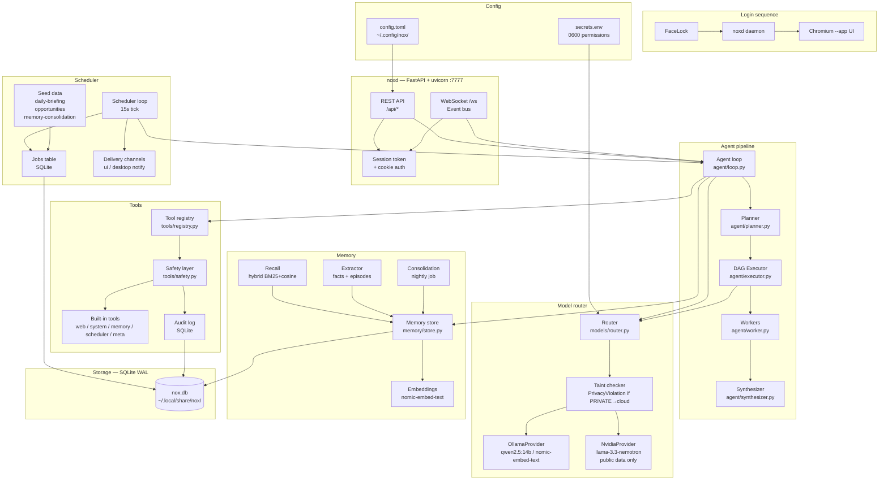

# NoX Architecture

## Overview

NoX is structured as a daemon-plus-thin-clients architecture. One always-on
background process (`noxd`) owns all logic, state, and model access. The web
UI and CLI are clients of its HTTP/WebSocket API.



## Data Flow — Chat Request

```
User → POST /api/chat
         ↓
       Auth check (cookie + CSRF)
         ↓
       Gate check (if mode=command)
         ↓
       Complexity gate → simple? → Agent loop
                       → complex? → Planner → DAG Executor
                                                ↓
                                         Workers (parallel, up to 2)
                                                ↓
                                         Synthesizer
         ↓
       WebSocket events pushed to UI (token, tool_call, plan_created, …)
         ↓
       Memory extraction (background, local model only)
```

## Privacy Routing

Every piece of content carries `TaintFlag` bits (`PRIVATE`, `UNTRUSTED`).
The router enforces:

- `PRIVATE` content → **local Ollama only**. Never sent to NVIDIA. Hard-coded
  in `models/router.py`, tested with a fake cloud provider.
- `UNTRUSTED` content → wrapped in `<untrusted_content>` tags before the model
  sees it. Escalates approval requirements for write/dangerous tool calls.

## File Layout

```
nox/
├── src/noxai/         Python package
│   ├── config.py      Load + validate config.toml
│   ├── db.py          SQLite helpers + migration runner
│   ├── taint.py       TaintFlag + Content wrapper
│   ├── logging_setup  Structured JSON logs
│   ├── cli.py         nx command
│   ├── models/        Provider, router (M1)
│   ├── agent/         Loop, planner, executor, workers (M3+M5)
│   ├── tools/         Registry, safety, builtins (M2)
│   ├── memory/        Store, embed, recall, extract (M4)
│   ├── scheduler/     Loop, jobs, seeds, delivery (M6)
│   ├── api/           FastAPI app, routes, WebSocket (M7)
│   └── prompts/       system.md and prompt templates
├── ui/                React + TypeScript + Vite + Tailwind (M8)
├── tests/             pytest test suite
├── docs/              Architecture, decisions, security, tool guide
├── systemd/           noxd.service user unit
├── hyprland/          nox.conf.snippet
└── scripts/           install.sh, nx-open.sh
```

## Key Design Principles

1. **Behavior is data** — jobs, schedules, sources, preferences are DB rows.
2. **Safety is code** — tiers, deny-lists, privacy routing cannot be prompted away.
3. **Daemon + thin clients** — one process owns all state.
4. **Local-first** — Ollama on the same machine; cloud only for public data.
5. **Everything observable** — every step emits a WebSocket event.
6. **Untrusted content is data** — web/RSS text is wrapped and taint-flagged.
7. **Fail soft** — model down? Degrade and keep running.
