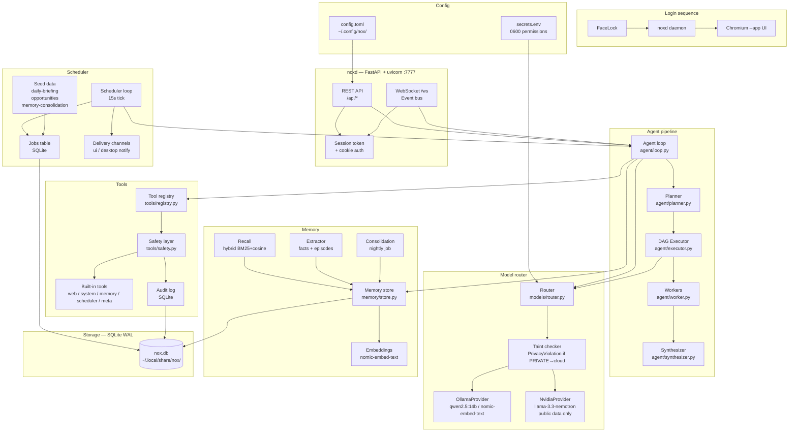

# NoX Architecture

## Overview

NoX is structured as a daemon-plus-thin-clients architecture. One always-on
background process (`noxd`) owns all logic, state, and model access. The web
UI and CLI are clients of its HTTP/WebSocket API.



## Data Flow — Chat Request

```
User → POST /api/chat
         ↓
       Auth check (cookie + CSRF)
         ↓
       Gate check (if mode=command)
         ↓
       Complexity gate → simple? → Agent loop
                       → complex? → Planner → DAG Executor
                                                ↓
                                         Workers (parallel, up to 2)
                                                ↓
                                         Synthesizer
         ↓
       WebSocket events pushed to UI (token, tool_call, plan_created, …)
         ↓
       Memory extraction (background, local model only)
```

## Privacy Routing (Privacy Policy v2)

Every piece of content carries `TaintFlag` bits (`PRIVATE`, `UNTRUSTED`) and belongs
to a `DataClass`:
- `SECRET`: API keys, passwords, credentials — **never sent to cloud**. Egress filter masks even inside chat.
- `LOCAL_ONLY`: File contents, local memories, shell output — **never sent to cloud**. Plain unlabeled strings fail closed as `LOCAL_ONLY`.
- `CHAT`: Conversation history and user prompts — cloud allowed only when `privacy.chat_to_cloud = true`, private mode is disabled, and no sensitive patterns are detected.
- `PUBLIC`: Web search results, fetched pages, RSS items — cloud allowed.

The router (`src/noxai/models/router.py`) and Egress Filter (`src/noxai/security/egress_filter.py`)
strictly block any request containing `SECRET` or `LOCAL_ONLY` content from leaving the machine,
logging decisions to the zero-data Egress Ledger.

## Milestone 10 Architecture: Fast Front Desk & Task Center

### 1. Reflex Router (< 0.1ms zero-LLM decision)
Interactive chat turns pass through a zero-LLM regex-based Reflex Router (`src/noxai/router/intent.py`)
operating with < 0.1ms mean latency (< 50ms hard threshold). The router classifies turns into 10 intent categories:
- `reply_now`: immediate direct conversation -> instant front desk.
- `reminder`: timer or reminder request -> instant acknowledgment + scheduled reminder tool.
- `schedule`: recurring job or cron schedule -> instant acknowledgment + job creation tool.
- `job_edit`: modifying or disabling scheduled jobs -> instant acknowledgment + job edit tool.
- `background_task`: long-running scripts, batch scans -> instant acknowledgment + Task Center queue.
- `deep_research`: comprehensive multi-source investigation -> queued to cloud or local deep research lane.
- `memory_op`: storing, searching, or forgetting facts -> instant local memory tool execution.
- `system_action`: file/system writes or commands -> approval required + local execution.
- `sensitive`: credentials, medical, or financial inputs -> 100% isolated to local lane.
- `ambiguous`: underspecified requests -> front desk prompts user for clarification.

### 2. Cloud Fallback State Machine & Rate Budget
Proactive health monitor (`src/noxai/models/cloud_health.py`) tracks cloud availability:
- `ACTIVE`: normal operation through cloud model (e.g., NVIDIA Nemotron).
- `NO_KEY`: missing API key -> immediate fallback to local brain with UI notice.
- `INVALID_KEY`: HTTP 401/403 -> automatic transition and local fallback.
- `RATE_LIMITED`: HTTP 429 or budget depletion -> automatic cooldown and local fallback.
- `DEGRADED`: high TTFT or intermittent timeouts -> hysteresis thresholding.
- `OFFLINE`: DNS or network failure -> circuit breaker opens after 3 consecutive failures.
- Circuit breaker automatically probes with half-open single request after cooldown.
- Token-bucket rate budget manager (`src/noxai/models/budget.py`) enforces 30 RPM capacity with a dedicated 10 RPM reserve protecting interactive front-desk turns from background depletion.

### 3. Task Center & Worker Pool
The Task Center (`src/noxai/tasks/center.py`) orchestrates asynchronous workloads:
- Persisted in SQLite `tasks` table (`schema_migrations/006_tasks.sql`).
- Priority queueing: `URGENT` (10), `HIGH` (20), `NORMAL` (30), `LOW` (40).
- Independent worker pools for local lane (`max_concurrent_local=2`) and cloud lane (`max_concurrent_cloud=2`).
- Cooperative cancellation tokens via `asyncio.Event` and database status tracking.
- Approval parking: when a tool requires human confirmation, background tasks suspend into `WAITING_APPROVAL` status until resolved via `/api/tasks/{id}/approve` or `/api/tasks/{id}/reject`.

### 4. UI Architecture & Observability
- `RouteChip`: Attached to assistant messages showing lane (local/cloud), model name, provider badge, and latency. Clicking opens the slide-out `TraceDrawer`.
- `TraceDrawer`: Slide-out panel detailing intent classification latency, data class, taint flags, tool calls, and event stream.
- `CloudStatusIndicator`: Status badge in header displaying live health state, with a popover revealing circuit breaker state, token budget gauges, interactive reserve, and cloud toggle.
- `TasksPage` (`/tasks`): Dashboard for viewing active and queued background jobs, progress bars, cancellation triggers, and parked approvals.

## File Layout

```
nox/
├── src/noxai/         Python package
│   ├── config.py      Load + validate config.toml
│   ├── db.py          SQLite helpers + migration runner
│   ├── taint.py       TaintFlag + Content wrapper
│   ├── logging_setup  Structured JSON logs
│   ├── cli.py         nx command
│   ├── models/        Provider, router (M1)
│   ├── agent/         Loop, planner, executor, workers (M3+M5)
│   ├── tools/         Registry, safety, builtins (M2)
│   ├── memory/        Store, embed, recall, extract (M4)
│   ├── scheduler/     Loop, jobs, seeds, delivery (M6)
│   ├── api/           FastAPI app, routes, WebSocket (M7)
│   └── prompts/       system.md and prompt templates
├── ui/                React + TypeScript + Vite + Tailwind (M8)
├── tests/             pytest test suite
├── docs/              Architecture, decisions, security, tool guide
├── systemd/           noxd.service user unit
├── hyprland/          nox.conf.snippet
└── scripts/           install.sh, nx-open.sh
```

## Key Design Principles

1. **Behavior is data** — jobs, schedules, sources, preferences are DB rows.
2. **Safety is code** — tiers, deny-lists, privacy routing cannot be prompted away.
3. **Daemon + thin clients** — one process owns all state.
4. **Local-first** — Ollama on the same machine; cloud only for public data.
5. **Everything observable** — every step emits a WebSocket event.
6. **Untrusted content is data** — web/RSS text is wrapped and taint-flagged.
7. **Fail soft** — model down? Degrade and keep running.
